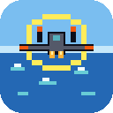
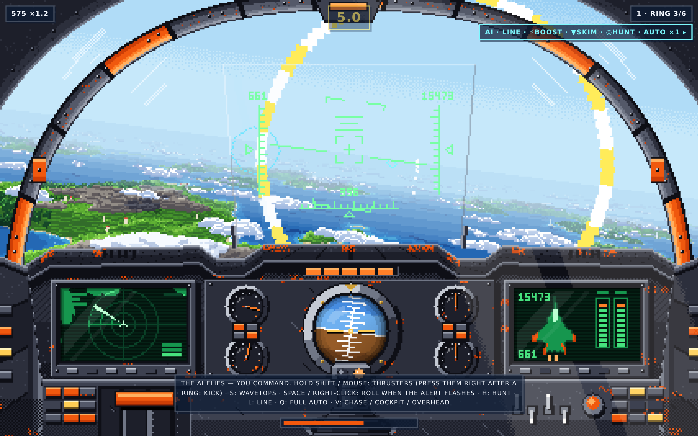
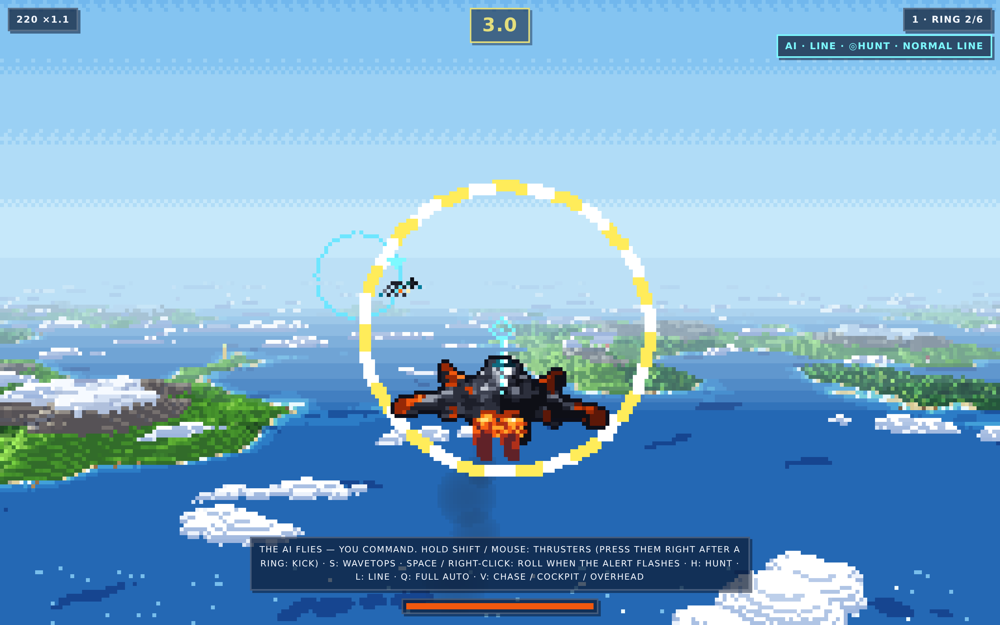
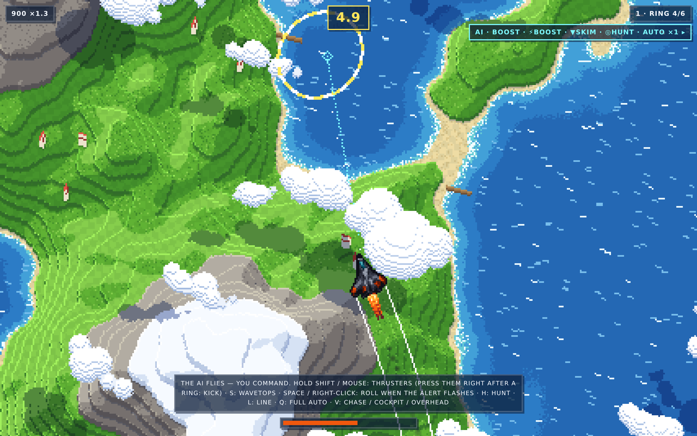
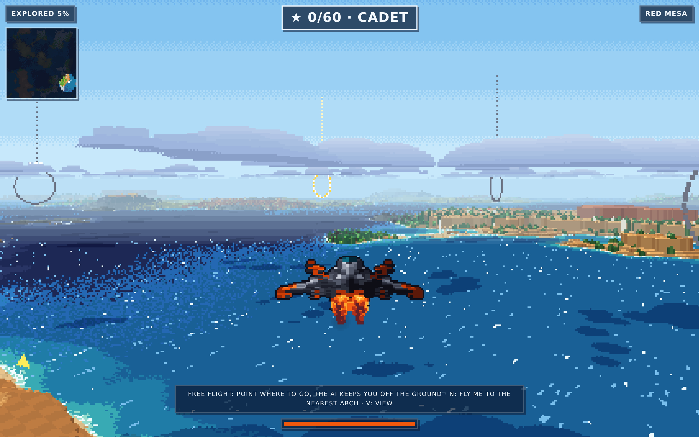

<div align="center">



# NEON WAVETOP

**The AI flies. You command. 40 measured courses over five biomes — thread the rings, kick out of them, outfly the expert.**

<a href="https://neon-wavetop.pages.dev"></a>

<a href="CHANGELOG.md"></a>
<a href="docs/assets/data/tests.json"></a>
<a href="mutations.txt"></a>
<a href="src/core/levels.tuned.ts"></a>
<a href="src/ai/reference.ts"></a>
<a href="src/ai/reference.ts"></a>
<a href="src/ai/pilot.ts"></a>
<a href="tsconfig.json"></a>
<a href="LICENSE"></a>

<sub>Public snapshot of v0.3.0 · published as is, not actively maintained</sub>

English · [中文](README.zh-CN.md)

[What it is](#what-it-is) · [Play](#play) · [How difficulty is set](#how-difficulty-is-set) · [Playtests](#playtests) · [Architecture](#architecture) · [How a course runs](#how-a-course-runs) · [Development](#development)

</div>

<table>
<tr><td></td><td></td></tr>
<tr><td></td><td></td></tr>
</table>

<sub>Screenshots are generated: `node scripts/e2e.mjs --shots shots` on the built page (1280×800, DPR 2).</sub>

A sprite-stack flight game in refined block-pixel style, built on the Stack3D kit of GameForge (the author's own game toolkit; its engine files are vendored in `src/engine/`) from
the owner's own sprite-stack fighter scene: a campaign of 20 levels, an open map in five biomes with a 20-course
league, three views (chase, cockpit, overhead), a rival ghost on every course, and playtests that record themselves.

## What it is

**A 3D-looking flight game with no 3D in it.** There is no WebGL, no 3D engine and not one image file: the jet is a
stack of flat pixel slices drawn one above the other, the islands are a height map marched column by column, and one
formula — `scale = S / (1 + q · depth)` — slides the same picture from an overhead map to a chase view to the cockpit
without a cut. Everything you see is computed by the code at run time.

**You do not fly it — you command it.** The autopilot holds the stick on every course. You give the orders a
wingman would: boost, skim the wavetops, roll when it calls the flak, lean on its line — and time the kick out of each
ring. The same autopilot, flown by an expert commander, is the ghost you race.

**The difficulty is measured, not guessed.** Each of the 40 courses has one knob, set by replaying 48 human-like
reference commanders; the simulation is deterministic, so every recorded run replays bit for bit.

**Size** (v0.3.0 build): the whole game is 172 KB on disk — about 65 KB over the wire, gzipped — in one script, one
worker and one page, with no runtime dependencies. The recorded soundtrack is separate (17 MB, optional; a generated
tune plays without it).

## Play

```bash
npm ci && npm run dev        # http://127.0.0.1:5173 (loopback only)
```

**The AI flies. You command.** On a course the autopilot holds the stick on every tick; what it will not decide
by itself is anything that spends, risks or times something — those are your orders.

| order | mouse | keys | touch | what it does |
|---|---|---|---|---|
| boost | hold left button | Shift | hold Boost | thrusters, on energy |
| ring kick | press boost right after a ring | same | same | free surge: energy back and +0.3 s |
| skim | — | hold S | Skim (toggle) | down to the wavetops to refill |
| roll | right button | Space | tap | when the alert flashes: dodge flak, stunt a diamond gate |
| hunt · line | — | H · L | — | go for balloons or stay on the line · safe / normal / racing line |
| full auto | — | Q (F: speed ×1–×16) | Auto | the expert AI commands itself — no stars for that run |
| view · retry · pause · sound | — | V · R · P · M | View · — · ❚❚ · — | |

**Tilt** (phones; on by default, the browser asks for the sensors at the first tap; Options → Tilt switches it off):

| Move the phone | On a course (an order to the AI) | Open skies |
|---|---|---|
| lean left / right | nudge the line it flies | turn |
| lean back | boost | climb |
| lean forward | skim | dive |
| shove it forward | a burst of boost — a ring kick when timed | a burst of boost |
| flick the wrist | roll | roll |

A pad above the buttons shows the lean on both axes and lights while boosting. View, auto and pause stay buttons.
Thresholds and axis signs were checked with synthetic sensor events, not yet on a real device.

In **open skies** you point where to go and the flight model keeps you off the ground; N (or Auto) flies you to
the nearest arch still to win.

- **Rings** pay seconds; a missed ring costs its pay and your combo, never the run.
- **Stars**: clear · under par · beat the expert commander's ghost. With no orders at all the AI flies a clean,
  slow course — the rest is you.

## How difficulty is set

Each course has one knob: the seconds a ring pays. It is measured, not guessed: 48 scripted casual commanders
(`src/ai/reference.ts`: late roll calls, bursts of boost, some skim, some hunt, some land the ring kick) command
the autopilot through the course with no clock, each run yields the exact pay it needed, and the knob is set
where the course's target share of them clears it. The expert commander never tunes anything.

```bash
npx tsx scripts/levels.ts --tune       # re-measure every course (minutes of CPU)
npx tsx scripts/levels.ts --check      # exact replay + gate
npx tsx scripts/levels.ts --explain 7
```

## Playtests

Menu → **Playtest data** → Copy / Download gives a text block of your clean runs (inputs of every tick, ring
log, your two-tap rating; no personal data). Send it to the developer, who runs:

```bash
npx tsx scripts/playtest.ts runs.txt      # replays each run, compares people with the reference player
```

## Architecture

<picture>
  <source media="(prefers-color-scheme: dark)" srcset="docs/assets/architecture-dark.svg">
  
</picture>

## How a course runs

<picture>
  <source media="(prefers-color-scheme: dark)" srcset="docs/assets/course-flow-dark.svg">
  
</picture>

## Development

```bash
npm ci
npm run dev          # http://127.0.0.1:5173
npm test             # vitest
npm run build        # type-check + production build into dist/
npm run levels:check # replays every tuned course exactly
```

This repository is a **public snapshot of v0.3.0**, published as it is and not actively maintained. The badges,
diagrams and screenshots are generated files from the original project; the scripts that regenerate them, the
browser end-to-end test and the deployment tooling are not part of this snapshot. `src/engine/` is vendored engine
code — treat it as read-only. `mutations.txt` lists the code mutations each test was proven to catch.

## Licence and credits

Code: see [LICENSE](LICENSE). The jet model is the owner's own pixel art. Sound effects and the fallback tune are synthesised in the page. The hosted build plays a recorded soundtrack that is **not** in this repository; without it the game plays the generated tune. Audio is never in git (`public/bgm/`).
