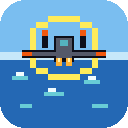
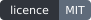
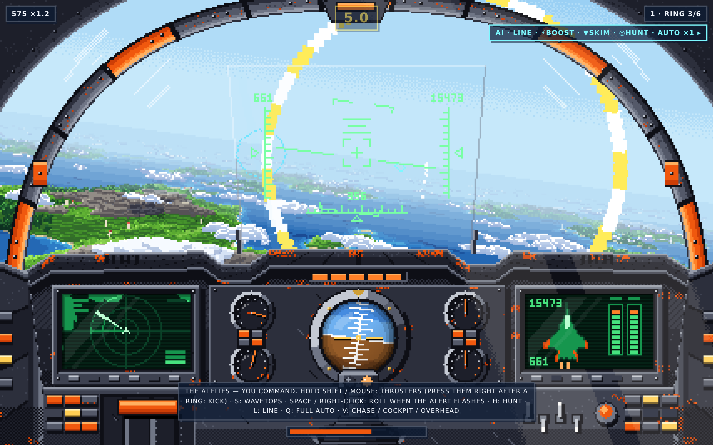
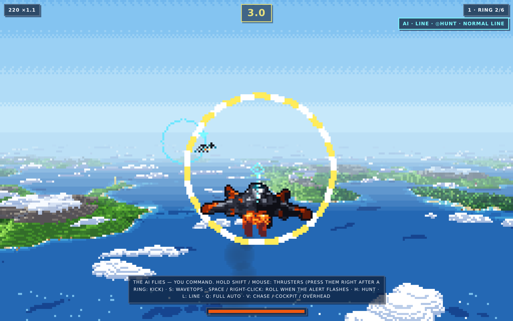
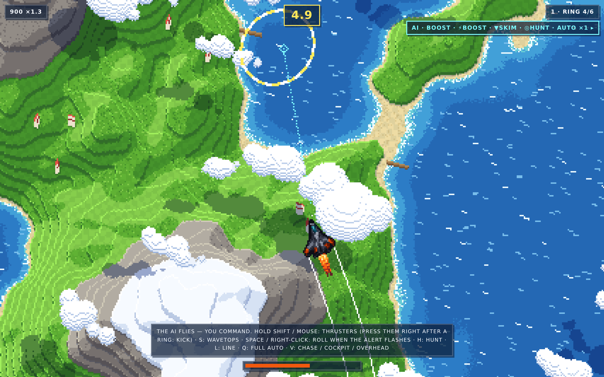
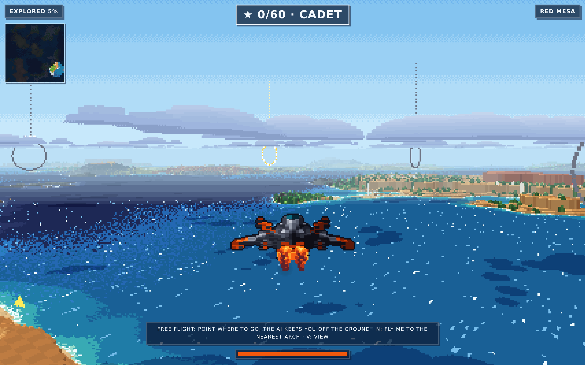

<div align="center">



# NEON WAVETOP · 霓虹掠海

**AI 驾驶，你指挥。五种地貌上 40 条实测难度的赛道 —— 穿环、环后点火、飞赢高手。**

<a href="https://neon-wavetop.pages.dev"></a>

<a href="CHANGELOG.md"></a>
<a href="docs/assets/data/tests.json"></a>
<a href="mutations.txt"></a>
<a href="src/core/levels.tuned.ts"></a>
<a href="src/ai/reference.ts"></a>
<a href="src/ai/reference.ts"></a>
<a href="src/ai/pilot.ts"></a>
<a href="tsconfig.json"></a>
<a href="LICENSE"></a>

<sub>v0.3.0 公开快照 · 按现状发布，不再积极维护</sub>

[English](README.md) · 中文

[它是什么](#它是什么) · [怎么玩](#怎么玩) · [难度怎么定](#难度怎么定) · [真人试玩](#真人试玩) · [架构](#架构) · [一条赛道怎么跑](#一条赛道怎么跑) · [开发](#开发)

</div>

<table>
<tr><td></td><td></td></tr>
<tr><td></td><td></td></tr>
</table>

<sub>截图由命令生成：对构建产物运行 `node scripts/e2e.mjs --shots shots`（1280×800，DPR 2）。</sub>

一款精细方块像素风的 sprite-stack 飞行游戏，基于 GameForge（作者自己的游戏工具箱，引擎文件已随仓库放在 `src/engine/`） 的 Stack3D 套件，蓝本是主人自己的
sprite-stack 战机场景：20 关闯关、五种地貌的开放地图与 20 条赛道的联赛、三种视角（追尾、座舱、俯视）、每条赛道都有的
对手幽灵机，以及会自己记录的真人试玩。

## 它是什么

**一个看起来是 3D、里面却没有 3D 的飞行游戏。** 没有 WebGL，没有 3D 引擎，也没有一张图片文件：战机是一摞平面像素切片逐层叠出来的，
岛屿是一张高度图按列扫描画出来的，而一条公式 `scale = S / (1 + q · depth)` 让同一幅画面从俯视地图连续滑到追尾视角再到座舱，
中间没有切镜。你看到的一切，都是代码在运行时算出来的。

**你不开飞机，你指挥它。** 每条赛道上握杆的都是自动驾驶。你下的是僚机长的命令：加力、掠海、它喊高炮时翻滚、推一把它的走线，
并掐准每个环之后的点火时机。同一个自动驾驶配上高手指挥官，就是和你竞速的幽灵机。

**难度是量出来的，不是猜的。** 40 条赛道每条只有一个旋钮，由 48 个类人参考指挥官重放定值；模拟是确定性的，每一局录像都能逐位重放。

**体积**（v0.3.0 构建）：整个游戏落盘 172 KB，gzip 后传输约 65 KB —— 一个脚本、一个 worker、一个页面，零运行时依赖。
录制的配乐另算（17 MB，可选；没有它时播放生成的曲子）。

## 怎么玩

```bash
npm ci && npm run dev        # http://127.0.0.1:5173（只绑本机）
```

**AI 驾驶，你指挥。** 赛道上每一 tick 握杆的都是自动驾驶；凡是要「花掉、冒险、掐时机」的事它不替你决定，
那些是你的命令。

| 命令 | 鼠标 | 键盘 | 触屏 | 作用 |
|---|---|---|---|---|
| 加力 | 按住左键 | Shift | 按住「加力」 | 开推进器，消耗能量 |
| 环后点火 | 过环后立刻按加力 | 同左 | 同左 | 白送一次冲刺：回能量，时钟 +0.3 秒 |
| 掠海 | — | 按住 S | 「掠海」（开关） | 压到浪尖回能 |
| 翻滚 | 右键 | 空格 | 轻点屏幕 | 警报亮起时：闪炮弹、菱形门特技 |
| 打气球 · 走线 | — | H · L | — | 追气球还是守线 · 稳妥 / 普通 / 竞速走线 |
| 全自动 | — | Q（F 调速 ×1–×16） | 「全自动」 | 高手 AI 自己下令 —— 那一局不计星 |
| 视角 · 重来 · 暂停 · 声音 | — | V · R · P · M | 视角 · — · ❚❚ · — | |

**重力感应**（手机默认开启，第一次点屏幕时浏览器会询问动作感应权限；可在 设置 → 重力感应 关闭）：

| 怎么动手机 | 赛道上（给 AI 的命令） | 开放空域 |
|---|---|---|
| 左右倾 | 推它的走线 | 转向 |
| 后仰 | 加力 | 爬升 |
| 前倾 | 掠海 | 俯冲 |
| 向前一推 | 一段加力，时机对就是环后点火 | 一段加力 |
| 甩一下手腕 | 翻滚 | 翻滚 |

按钮上方的方块显示两个方向的倾斜量，加力时边框变亮。视角、全自动、暂停仍是按钮。
阈值与轴向目前只用模拟传感器事件验证过，尚未在真机上测量。

在**开放空域**里你只管指方向，飞行模型负责贴地避障；按 N（或「全自动」）会自动飞往最近一座还没拿下的拱门。

- **环**给时间；漏一个只丢它的时间和连击，流程不断。
- **三颗星**：通关 · 快过标准时间 · 击败高手指挥官的幽灵机。完全不下命令时 AI 会飞出一条干净但慢的航线 —— 其余全看你。

## 难度怎么定

每条赛道只有一个旋钮：一个环给多少秒。它是测出来的：48 个脚本化的「普通指挥官」（`src/ai/reference.ts`：翻滚喊得晚、
加力一阵一阵、有人掠海有人不、环后点火只中一部分）在无时钟下指挥自动驾驶飞完，每局精确得出「至少要给多少秒」，
旋钮定在目标通过率对应的位置。高手指挥官从不参与调参 —— 它变强不会让人更难。

```bash
npx tsx scripts/levels.ts --tune       # 重新测量每条赛道（需要几分钟 CPU）
npx tsx scripts/levels.ts --check      # 精确重放 + 门禁
npx tsx scripts/levels.ts --explain 7
```

## 真人试玩

菜单 → **试玩数据** → 复制 / 下载，得到一段文本：你每一局干净手动局的逐 tick 操作、过环记录和两下点击的评价
（不含任何个人信息）。发给开发者后运行：

```bash
npx tsx scripts/playtest.ts runs.txt      # 逐局重放，把真人和参考玩家放在同一把尺子上比
```

## 架构

<picture>
  <source media="(prefers-color-scheme: dark)" srcset="docs/assets/zh/architecture-dark.svg">
  
</picture>

## 一条赛道怎么跑

<picture>
  <source media="(prefers-color-scheme: dark)" srcset="docs/assets/zh/course-flow-dark.svg">
  
</picture>

## 开发

```bash
npm ci
npm run dev          # http://127.0.0.1:5173
npm test             # vitest
npm run build        # 类型检查 + 生产构建到 dist/
npm run levels:check # 精确重放每条已调好的赛道
```

本仓库是 **v0.3.0 的公开快照**，按现状发布，不再积极维护。徽章、图和截图是原项目生成的文件；重新生成它们的脚本、
浏览器端到端测试和部署工具不在这份快照里。`src/engine/` 是随仓库附带的引擎代码，请当作只读。
`mutations.txt` 列出每个测试被证明能抓住的代码变异。

## 许可与致谢

代码见 [LICENSE](LICENSE)。战机模型是主人自己的像素画。音效与兜底旋律在页面里合成。线上版本播放的录制配乐**不在**本仓库里；没有它时游戏播放生成的曲子。音频不进 git（`public/bgm/`）。
